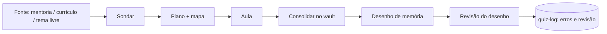

# Manual do sistema

Argument: `$ARGUMENTS`

## How to answer

1. Run `python3 .claude/tools/status.py` (read-only snapshot: setup checks, concepts, mentorship lessons, curriculum queue, quiz stats, drawings, sessions).
2. **No argument** → give the **visão geral**: what the system is (one short paragraph), the study cycle diagram, the command table, the three workflows in a few lines each, then **"Seu estado agora"** (from the snapshot, only what matters) and **one concrete suggested next step** (see *Choosing the next step*).
   **With a topic** → explain only that part, in depth, from the reference below, plus the relevant slice of the state.
   **"o que faço agora?"** → state + next step only.
3. Answer in Brazilian Portuguese, as markdown in chat. Keep the overview scannable (tables, short lists); it should fit in one screen or two. Don't paste this whole file. Any ✗ in the setup checks goes first, with how to fix it.
4. If the reference below disagrees with the actual files (a command or script missing, a path moved), trust the files, say what differs, and suggest updating this manual.

## Choosing the next step

In order — pick the first that applies:
1. A setup check is ✗ → fix it (see *Problemas*).
2. A drawing without review → `/revisar-desenho`.
3. A placement in progress → `/nivelamento continuar`.
4. Concepts with `status: revisar` → a short `teach` session on the first one.
5. No `LEARNING.md` → `/nivelamento` (or `/mentoria <transcript>` if they have a lesson at hand).
6. Otherwise → the first unchecked item of the *Study queue* (the integrated roadmap): a `mentoria:` item → `/mentoria continuar`; a lesson → `/curriculo`. Say which stage (`### Etapa N`) it belongs to. If the queue has no `mentoria:` items but a mentorship lesson has pending blocks → `/mentoria continuar`.

---

# Reference

## O que é

Um sistema de estudo de AI engineering dentro do Claude Code, adaptado do [amosblomqvist/learn](https://github.com/amosblomqvist/learn) (feito para o agente pi). O Claude ensina com um método fixo (`teach`), confere com quizzes corrigidos por script, e tudo que é aprendido vira conteúdo no vault do Obsidian `~/Documents/AI Engineering/`, ligado como um grafo.

**Duas fontes de profundidade:**
- **Mentoria** (transcripts das aulas) → profundidade **prática**: problemas reais, decisões, trade-offs. Densa, com muita coisa pressuposta.
- **Currículo** [ai-engineering-from-scratch](https://github.com/rohitg00/ai-engineering-from-scratch) (`curriculum/`) → profundidade de **mecanismo**: matemática, código do zero.

A unidade de estudo é o **conceito** (uma nota em `Conceitos/`), não a fonte: as duas fontes alimentam as mesmas notas. Uma sessão = um conceito.

## O método (`teach`)

Dois princípios: **(i) verdades incondicionais primeiro** — começar pelo que se aceita sem ressalva; **(ii) "como eu poderia ter descoberto isso?"** — cada passo motivado, nada surge do nada.

Toda sessão tem 4 fases:
1. **Sondar** — quizzes até achar a *borda* do seu conhecimento (um acerto embaixo, um erro em cima), e o objetivo da sessão.
2. **Planejar** — fontes reunidas (mentoria motiva, currículo estabelece), mapa de dependências em Mermaid; **você aprova antes de começar**.
3. **Ensinar** — nó por nó: motivar → estabelecer → conectar → quiz.
4. **Consolidar** — nota da aula + notas de conceito no vault, `00 Mapa` atualizado, sugestão de `/desenho`.

Qualquer explicação segue o método, mesmo uma pergunta rápida (em versão curta, sem consolidar).

**Onde a aula aparece:** numa sessão de estudo, o plano e cada nó são escritos na **nota da aula** (`Aulas/Currículo/…`, `Aulas/Mentoria/…`, `Aulas/Livre/…`), aberta no Obsidian (LaTeX e Mermaid renderizados) e atualizada ao vivo. O terminal fica só com avisos curtos ("nó 2 está na nota"), os quizzes no popup e suas perguntas avulsas. A consolidação no fim só arruma essa nota. Perguntas rápidas continuam no terminal.

## O ciclo de estudo



## Comandos

| Comando | Para quê |
|---|---|
| `/manual [tema]` | Este manual + seu estado + próximo passo |
| `/mentoria <transcript>` | Importa uma aula da mentoria e estuda bloco a bloco |
| `/mentoria continuar` | Retoma a aula da mentoria com blocos pendentes |
| `/nivelamento` | Nivelamento adaptativo (40–70 min, pode pausar) → plano aula a aula em `LEARNING.md` |
| `/nivelamento continuar` · `refazer` | Retomar · recalibrar vertentes ou refazer tudo |
| `/curriculo [aula ou tema]` | Próxima aula da fila (ou uma específica) com o método |
| `/guia-curso <tema>` | Qual aula do currículo cobre um tema |
| `/prova-fase <fase>` | Prova de uma fase inteira do currículo |
| `/desenho [tema]` | Cria um desenho de memória no Excalidraw e abre no Obsidian |
| `/revisar-desenho` | Revisa o desenho: certo / faltando / errado, e registra |
| `/md-log [nota \| off \| status]` | Espelha a sessão numa nota (já é automático em sessões de estudo) |
| *(perguntar normalmente)* | Tema livre — o `teach` cuida; diagramas pelo `visualize` |

Agentes que o Claude usa sozinho: `researcher` (confere fatos na web), `mermaid-maker` e `svg-maker` (diagramas verificados visualmente).

## Fluxos

**Aula da mentoria** — `/mentoria <arquivo.txt>` → título e data → o transcript vai intacto para `Fontes/Mentoria/` com parágrafos citáveis (`^p12`) → análise: blocos, o que foi *dito / pressuposto / pulado*, afirmações a verificar, ligação com o currículo → nota `00 Visão geral` → **triagem** por quiz (bloco absorvido = só consolidar; não absorvido = aula completa; falta base = pré-requisito antes) → uma sessão por conceito, sempre citando o trecho do mentor → `/mentoria continuar` nas próximas vezes.

**Currículo** — `/nivelamento` uma vez (rota de carreira + escopo, busca binária em 15 vertentes, separa vocabulário de mecanismo) → `LEARNING.md` com a fila → `/curriculo` a cada sessão: aquecimento, sondagem com as perguntas da aula, plano, aula (você digita o código em `pratica/`), prova pós-aula, consolidação. Itens `confirmar` da fila recebem só a prova. Ao fim de uma fase, `/prova-fase`.

**Roteiro integrado** — a *Study queue* do `LEARNING.md` mistura as duas fontes em etapas (`### Etapa N`). Cada semana da mentoria vem em itens `mentoria:` (triagem, depois grupos de blocos), com as aulas do currículo que dão o mecanismo dela antes ou logo depois, e 1–2 aulas de base (math/ML/DL) por etapa, no ritmo 2:1. O que não entrou em nenhuma etapa fica em *Depois*, na ordem do nivelamento. O próximo passo é sempre o primeiro item não feito: `/mentoria continuar` ou `/curriculo`. Uma semana nova da mentoria vira uma etapa nova antes de *Depois*.

**Tema livre** — pergunte; o `teach` sonda, planeja (você aprova), ensina e consolida em `Aulas/Livre/`.

Fechamento de qualquer fluxo: `/desenho` → você desenha de memória com a caneta → `/revisar-desenho`.

## Quiz

Abre numa janela flutuante (foot com app-id `TUI.float`; dentro do tmux, um popup).
- **↑↓** ou **1–9** escolher · **Enter** responder · **espaço** marcar (quando há várias corretas) · **Tab** escrever uma nota · **Esc** cancelar.
- **"Não sei"** é sempre uma opção — use sem medo: vira lacuna a ensinar, não erro a corrigir. Chutar estraga o diagnóstico.
- A **nota** (Tab) é lida pelo Claude: explique seu raciocínio quando estiver em dúvida.
- Depois de responder: ✓/✗, a resposta certa e a explicação. Enter fecha.
- Tudo fica em `.claude/state/quiz-log.jsonl` (vira "Erros que eu cometi" nas notas de conceito).

## Vault (`~/Documents/AI Engineering/`)

| Pasta / nota | O que tem |
|---|---|
| `00 Mapa.md` | Índice: trilhas (mentoria, currículo), conceitos por status, fila de aprofundamento |
| `Conceitos/` | Os **nós** do grafo — uma nota por conceito; `Depende de::` / `Usado em::` são as **arestas** (veja no Graph View). Seções *Mecanismo*, *Na prática*, *Erros que eu cometi*, *Desenhos* |
| `Aulas/Mentoria/<aula>/` | `00 Visão geral` + uma nota por bloco explicado |
| `Aulas/Currículo/<fase>/` | Uma nota por aula do currículo |
| `Aulas/Livre/` | Temas avulsos |
| `Aulas/Nivelamento <data>.md` | Resultado do nivelamento |
| `Fontes/Mentoria/` | Transcripts brutos (nunca editados) |
| `Desenhos/` | Desenhos `.excalidraw.md` + PNG exportado |
| `Sessões/` | Registro bruto de cada sessão (md-log) |
| `viz/` | Diagramas gerados |
| `Templates/` | Modelos de Conceito e Aula |

Status de conceito: **aprendendo** (primeira sessão) → **sólido** (passou no quiz e se manteve depois, num quiz ou desenho) ↔ **revisar** (escorregou). O nivelamento nunca marca nada como sólido. Suas anotações nas notas são preservadas — o Claude só acrescenta.

## Desenho

`/desenho` cria `Desenhos/<tema>-<data>.excalidraw.md` só com título e enunciado e abre no Obsidian. Desenhe **de memória** (modo caneta do Excalidraw ligado) — a referência só aparece na revisão, de propósito. Ao salvar, o plugin exporta o PNG; `/revisar-desenho` olha a imagem, compara com o mapa da aula e as fontes, aponta certo / faltando / errado, faz quiz nos erros e registra nas notas.

## Diagramas

Simples → bloco ```` ```mermaid ```` direto no texto (o Obsidian renderiza). Delicados ou geométricos → `mermaid-maker` / `svg-maker`, que renderizam, **olham o resultado** e publicam em `viz/`, embutido como `![[viz-….png|500]]`.

## Onde fica cada coisa (projeto `~/Study/ai-engineer/`)

- `CLAUDE.md` — regras e contexto que o Claude lê sempre.
- `curriculum/` — clone do currículo (não editar). `pratica/` — o código que você digita nas aulas.
- `LEARNING.md` — plano e progresso: o roteiro integrado (currículo + mentoria).
- `.claude/skills/` — os comandos; `.claude/agents/` — researcher e makers.
- `.claude/tools/` — `quiz.py`, `md_log.py`, `import_transcript.py`, `drawing.py`, `render.sh`, `placement.py` + `strands.json`, `status.py`, `open_note.py`.
- `.claude/state/` — log de quizzes, vínculos do md-log (pode apagar sem perder conteúdo do vault).
- `.claude/settings.json` — permissões e hooks (o md-log roda após cada quiz/pergunta e ao fim de cada turno).

## Manutenção

- Atualizar o currículo: `git -C curriculum pull`, depois `python3 .claude/tools/placement.py check` (avisa se alguma aula das vertentes mudou de nome).
- Testes do quiz: `python3 -m unittest discover -s .claude/tools/tests`.
- Ajustar o método: edite `.claude/skills/teach/SKILL.md` — é o coração do sistema; o autor original recomenda adaptá-lo a como você aprende.

## Problemas

| Sintoma | Solução |
|---|---|
| Quiz não abre / "Quiz unavailable" | Precisa de sessão gráfica (Wayland) ou tmux; `foot` instalado. Rode o Claude Code num terminal da sessão gráfica. |
| Quiz abre em tela cheia, não flutuando | A regra do Omarchy para `TUI.float` não pegou — ajustar regra de janela no Hyprland (skill `omarchy`). |
| Desenho abre como texto | Plugin Excalidraw desligado; ou menu `⋯` → *Switch to Excalidraw view*. |
| `/revisar-desenho` diz que não há PNG | Ligar *Auto-export PNG* (Excalidraw › Embedding… › Export Settings › Auto-export Settings) e salvar o desenho de novo. |
| Desenhos novos caem na pasta `Excalidraw/` | Excalidraw › *Excalidraw folder* = `Desenhos`. |
| Sessão não aparece em `Sessões/` | `/md-log status`; se o projeto foi aberto antes dos hooks existirem, reinicie o Claude Code. |
| Diagrama do maker falha | `.claude/tools/render.sh mermaid <arquivo> <saida.png>` para ver o erro; o mermaid usa o `/usr/bin/chromium`. |
| Skill do repo (`learn`, `start-learning`…) aparecendo | Use os nossos (`/curriculo`, `/nivelamento`); abra o Claude Code em `~/Study/ai-engineer`, não dentro de `curriculum/`. |
