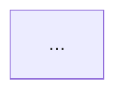

# Mentoria — from a dense lesson to understood knowledge

The mentor's lessons are **dense**: the difficulty is rarely in what was said, but in what was left implicit. This skill turns one lesson into a map of what it actually rests on, finds which parts the learner didn't absorb, and re-explains those with the `teach` method — anchored to the mentor's own words.

Everything the learner reads goes in the vault, `~/Documents/AI Engineering/`. Follow the `teach` skill for every quiz, explanation and consolidation; this skill only adds the mentorship-specific steps.

The mentorship is one of two depth sources: it gives **practice** depth (real problems, decisions, trade-offs). The curriculum in `curriculum/` gives **mechanism** depth (math, from-scratch code). Use both, as `teach` describes.

## Modules (one week = several sources)

The mentorship (Praxis) runs in weeks. Each week is a **module** with several sources: one or two recorded **pré-aulas** (concept introduction — usually the best source for *motivate* and first *establish*), the **aula ao vivo** (practice, production code, Q&A — the practice depth) and sometimes a **resumo** (the mentor's own summary — useful to check the block division and the main points, never the primary source to cite for a claim).

- Each source is imported as its own note in `Fontes/Mentoria/` named `S<NN> <tipo> <tema>` (e.g. `S02 Pré-aula LangChain`), all pointing to the same module.
- One module folder per week: `Aulas/Mentoria/S<NN> <tema>/` with one `00 Visão geral.md` covering **all** the week's sources. Blocks are by topic, and a block may draw on several sources (the concept from the pré-aula, the implementation from the live class) — list each source's paragraph range in the block row.
- Week numbers come from the transcripts themselves ("semana 4", "pré-aula 1 dessa semana 2"); use them as the prefix instead of a date when the lesson date isn't known.

## Routing

- **A transcript path, or pasted transcript text** → Step 1 (import).
- **Several files at once** → group them into modules (by week/topic, from the file names and first lines; confirm the grouping only if it's ambiguous), import every file (Step 1, with `--prefix S<NN> --modulo "S<NN> <tema>" --tipo pre-aula|aula|resumo`, and `--markdown` for a summary note), then run Steps 2–3 **per module**. Modules are independent: delegate each module's analysis to its own `general-purpose` subagent in parallel (give it this skill's Steps 2–3 and the module's source note names; it writes the module's `00 Visão geral.md` and reports a short summary). Then update `00 Mapa.md` yourself, present a table of modules (blocks, prerequisites, claims flagged), and suggest which module to triage first — triage (Step 4) is interactive, one module at a time, in later sessions.
  Pasted text: write it verbatim to `.claude/state/inbox/<slug>.txt` first, then import that file.
- **`continuar`, or no argument** → if `LEARNING.md`'s *Study queue* has an unchecked `mentoria:` item, the integrated roadmap decides: the **first** such item is next (its module and `triagem` → Step 4, or `blocos a–b` → Step 5) — say which and go, no question. If a curriculum lesson sits before it in the queue, mention it in one line ("antes dele na fila: <aula> — `/curriculo`") but proceed with the mentorship item. No `mentoria:` items in the queue → read every `Aulas/Mentoria/*/00 Visão geral.md`, list lessons with pending blocks, ask which to continue (AskUserQuestion), then go to Step 5 for that lesson.

## Step 1 — Import the raw transcript

Ask (AskUserQuestion, unless already given or inferable from the transcript) for the lesson **title** and **date** (or week). Then:

```bash
python3 .claude/tools/import_transcript.py "<file>" --title "<título>" --date <YYYY-MM-DD>
# or, as part of a weekly module:
python3 .claude/tools/import_transcript.py "<file>" --prefix S<NN> --title "<Pré-aula|Aula> <tema>" --modulo "S<NN> <tema>" --tipo <pre-aula|aula|resumo> [--markdown]
```

This writes `Fontes/Mentoria/<date> <title>.md` — the transcript **intact**, split into paragraphs ending in block ids `^p1…^pN`. Never edit that note afterwards. It prints the note name (call it `<fonte>`), paragraph count and whether the lesson is short or long.

Every reference to the mentor's words, everywhere in the vault, is a block link: `[[<fonte>#^p12]]` (a range is cited by its first and last paragraph: `[[<fonte>#^p12]]–[[<fonte>#^p15]]`). Quote the passage briefly when it matters; the link takes the learner to the exact spot.

## Step 2 — Read and analyse the whole lesson

Read the full source note (in parts if it's long). Then work out:

1. **Terms the transcription got wrong** — "rague" → RAG, "lang chain" → LangChain, "embedins" → embeddings. Build a correction glossary; use the correct terms everywhere else. The raw note stays as is.
2. **Blocks** — split the lesson into topic blocks, each a contiguous paragraph range. A short lesson usually has 1–2; a long one 4–10. A block is one coherent idea the mentor developed, not a fixed size.
3. **Per block, classify the content:**
   - **Dito** — what the mentor actually explained (with `^p` links).
   - **Pressuposto** — what the mentor used without explaining ("aí você joga no vector store…"). These become prerequisite nodes.
   - **Pulado** — reasoning steps the mentor jumped over ("então obviamente usamos overlap"). These are prime spots for "how could I have discovered this?".
4. **Claims to verify** — anything that sounds wrong, outdated, or like a deliberate simplification. Batch them into one `researcher` call (with the quoted claims) rather than many.
5. **Cross-reference:**
   - the vault: which `Conceitos/` notes already exist for these ideas (and their `status`);
   - the curriculum: which lessons in `curriculum/phases/` cover the mechanism (search lesson directory names and `phases/*/README.md` tables; read the candidate `docs/en.md` headings to confirm).
6. **Lesson map** — one dependency graph for the whole lesson: prerequisites (assumed concepts) at the roots, blocks in the middle, the lesson's goal as the sink. Small and readable; this is the map of the lesson, not of each block.

## Step 3 — Write the overview note

Create `Aulas/Mentoria/<módulo>/00 Visão geral.md` (for a single-source lesson the module is the source note's name):

~~~markdown
---
tags: [aula, mentoria]
fontes: ["[[<fonte 1>]]", "[[<fonte 2>]]"]
semana: <S<NN> or date>
status: em andamento
---
# <título do módulo>

**Resumo:** <3–5 frases: o que a aula ensina e qual problema resolve>

## Mapa da aula


## Blocos
| # | Bloco | Trecho | Triagem | Status |
|---|---|---|---|---|
| 1 | [[01 <bloco>]] | [[<fonte>#^p1]]–[[<fonte>#^p14]] | — | pendente |

## Pressupostos (pré-requisitos)
- [[Conceito]] — onde aparece ([[<fonte>#^p7]]) · no vault: sólido / aprendendo / não existe · currículo: `phases/…/…`

## Passos pulados
- Bloco 2: <o salto> ([[<fonte>#^p22]])

## Para verificar
- "<afirmação>" ([[<fonte>#^p31]]) → <resultado do researcher: correto / simplificação (versão completa: …) / divergente>

## Glossário de correções da transcrição
| Transcrito | Correto |
|---|---|

## Currículo relacionado
- `phases/<fase>/<aula>` — <o que cobre>
~~~

Block links like `[[01 <bloco>]]` point at notes created in Step 5; it's fine that they don't exist yet. Add the lesson to the *Trilha — Mentoria* table in `00 Mapa.md`.

**Integrated roadmap.** If the module is new to `LEARNING.md`'s *Study queue*, add it as a new stage `### Etapa N — <tema> · S<NN>` right before `### Depois` (or, if a stage already waits for this week — e.g. "a semana de evals, quando chegar" — put its items in that stage). The stage holds: `- [ ] mentoria: <módulo> — triagem dos <n> blocos[ + blocos 1–k: …] · mentoria · triagem…` and then the remaining block groups (2–4 blocks per item, by topic); the curriculum lessons from this overview's *Currículo relacionado* that are prerequisites (before the block they support) or mechanism (right after), moved out of *Depois* if they're there, or added as `fazer`/`confirmar` if missing; and the next 1–2 **base** lessons (math/ML/DL) from the front of *Depois* — the learner chose the 2:1 rhythm. Keep the stage small (~5–7 h); say in chat what moved.

Show the learner the summary, the lesson map and the block table in chat, then go to triage.

## Step 4 — Triage (find what didn't land)

The learner may have attended live, so don't re-teach what they already absorbed. For **each block**, ask 2–3 quiz questions built from what the mentor *said* (`topic` = the block's main concept) — following the `teach` option-construction procedure. Include one question on a **pressuposto** whenever the block leans on one the vault doesn't show as `sólido`.

Classify each block and record it in the *Triagem* column:
- **ok** — everything right → light consolidation only (block note + concept notes, no full lesson).
- **parcial** / **não absorvido** — misses or "Não sei" → full `teach` session(s).
- **falta base** — the misses trace back to a prerequisite → teach the prerequisite first (curriculum lesson as the mechanism source), then the block.

Then propose an order (prerequisites first, then blocks in lesson order), present it, and confirm with AskUserQuestion. One concept per session; a heavy block may take several sessions — say so. The roadmap's curriculum lessons already sit next to the block groups; a prerequisite found here that isn't in the stage goes in right before its block (moved from *Depois* or added). Blocks triaged **ok** need only light consolidation: do it right after triage. Check off the `triagem` item in `LEARNING.md`.

## Step 5 — Re-explain, block by block

Run the `teach` skill for the next pending item, with these specifics:

- **Sources**: the block's paragraphs (the primary text — re-read them before the session), the related curriculum lesson(s), the researcher's verdicts, and the vault.
- **Probe** is shorter than usual: triage already mapped this block. Probe only the strands the triage left unclear.
- **Teach anchored to the mentor**: for each dense passage, quote it with its link, then unpack it: *"Em [[<fonte>#^p23]] o mentor disse X. Por que X? Vamos reconstruir…"* Use the mentor's real problem to **motivate**, the curriculum's mechanism to **establish**, and show how the mechanism explains the mentor's practical decision to **connect**.
- Where the researcher found a simplification or divergence, teach the full version and say plainly that the mentor simplified — no judgment, it's normal in a dense lesson.

## Step 6 — Consolidate the block

`teach` Phase 4, with the lesson note at `Aulas/Mentoria/<fonte>/<NN> <bloco>.md`:

~~~markdown
---
tags: [aula, mentoria]
fonte: "[[<fonte>]]"
trecho: "^p<a>–^p<b>"
status: concluída
---
# <bloco>  (mentoria <date>)

## O que o mentor disse
> "<citação curta>" [[<fonte>#^p23]]

## Pressupostos desta parte
- [[Conceito A]] ← ensinado como pré-requisito
- [[Conceito B]] ✓ já sólido

## Desdobrando
<a explicação construída na sessão, nó por nó, com links para [[Conceitos]]>

## Mapa
```mermaid
graph TD
```

## Quizzes
<placar e erros que valem lembrar>

## Desenho
<!-- preenchido por /desenho e /revisar-desenho -->

## Próximos passos
~~~

In each concept note: practical content from the mentor goes under *Na prática* with the `^p` link; add the source to `fontes:` (e.g. `"mentoria <date>"`). Update the block row (Triagem / Status) in `00 Visão geral.md`, and `00 Mapa.md` (trail, concept status, deepening queue). When every block is done, set the overview's `status: concluída`. In `LEARNING.md`, check off the `mentoria:` item once all of its blocks are done, and log it in *Progress log* (`mentoria S<NN> blocos a–b`, quiz score, one line on what was hard).

At the end of each session, suggest `/desenho` for the block's main idea, and name the next pending item so the learner can resume with `/mentoria continuar`.
